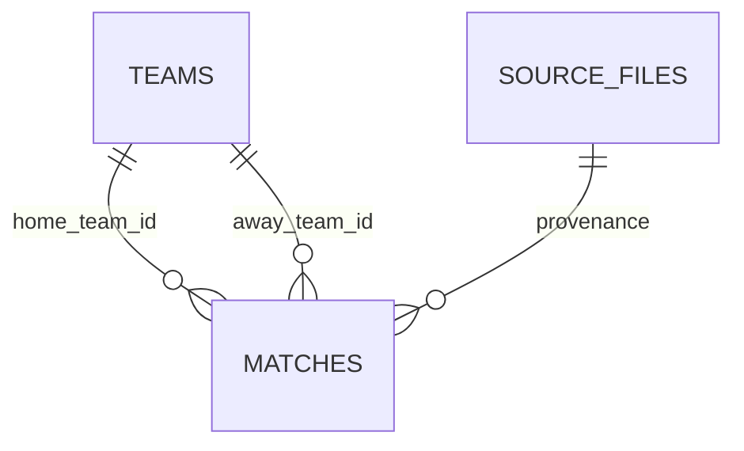

# Mỗi dòng đại diện cho gì?

- `teams`: một đội; `team_id` khóa chính, `name` là nhãn nguồn (Man City, Man United...).
- `matches`: một trận đã có tỷ số; `match_id` khóa nội bộ, không phải mã chính thức PL. `source_row`: dòng CSV tính cả header là dòng 1. Cặp home/away duy nhất trong mùa. `played_on` YYYY-MM-DD, `kickoff_time` HH:MM theo nhãn thời gian nguồn, không tự đổi timezone.
- `home_team_id`, `away_team_id`: hai khóa ngoại đến cùng bảng teams. Không được giống nhau.
- `home_goals`,`away_goals`: bàn thắng nguyên không âm; `result`: H chủ nhà thắng, D hòa, A khách thắng. Kiểm tra phù hợp tỷ số.
- Mỗi bên có `shots` số sút, `target` sút trúng đích, `corners` phạt góc, `yellow` thẻ vàng, `red` thẻ đỏ. Số nguyên không âm hoặc NULL nếu thiếu. Giữ định nghĩa nhà cung cấp; không suy ra thống kê cầu thủ.
- `source_files`: URL, SHA256 duy nhất, downloaded_at UTC, byte_count. Khi dùng CSV thủ công, thời gian là lúc đăng ký snapshot trên máy; không khẳng định biết thời điểm file được tải ban đầu.
- `metadata`: khóa/giá trị về mùa, loại dữ liệu và ngữ nghĩa ngày.

`team_matches` là kết quả SQL tạm bằng UNION ALL, **hai dòng cho mỗi trận**, mỗi dòng một đội. `gf` bàn thắng của đội, `ga` bàn thua, `points` điểm đội kiếm được. Vì vậy COUNT(*) trên bảng này gấp đôi số trận; SUM(gf) là tổng bàn toàn giải và phải bằng SUM(ga). Đếm số trận nguồn từ matches.

`standings`: một dòng mỗi đội, `rank` dùng RANK theo điểm/GD/GF; hòa cả ba giữ chung hạng. `home_away`: một đội + một loại sân. `last5_form`: một đội, tối đa5 trận đến mốc, `recent_played` là mẫu số thật. `monthly`: một tháng trong mùa, tháng chưa đến mốc giữ trống; tháng đã quan sát không trận là0.

NULL không phải 0. Không JOIN đội với toàn lịch sử rồi SUM lại điểm bảng đội. Bảng mùa thật được kiểm tra đủ20đội/380trận, mỗi đội19sân nhà19khách và mỗi cặp có đúng hai lượt đảo sân.

## Kiểm soát bóng bổ sung (v1.1)

- `possession_sources`: một file nguồn, URL chốt commit, SHA256 và thời điểm nhập UTC; 38 file GW + teams.csv. Không ghép bằng tên gần giống; ánh xạ rõ Man Utd → Man United, Spurs → Tottenham; mã `code` của teams.csv là mã trong nguồn trận phụ, không phải `id` hoặc khóa nội bộ.
- `match_possession`: tối đa một dòng mỗi match_id, FK đến trận, file/dòng gốc và mã trận nguồn phụ; `home_bp`/`away_bp` lưu phần trăm bằng số nguyên 0,01 điểm phần trăm. 6360 = 63,60%. Hai phía hợp lệ cộng 10000.
- `status`: valid, missing hoặc score_conflict. Dòng thiếu/xung đột lưu cả hai tỷ lệ NULL, kèm reason; không giả dữ liệu. Mọi thay đổi bảng bổ sung và nhập 380 dòng trong cùng transaction; không ghi đè kết quả trận chính.
- `avg_possession_pct`: trung bình cộng các trận hợp lệ, không trọng số thời gian; `possession_matches`: số trận được dùng; `possession_missing`: số đã đá đến mốc trừ số được dùng. AVG bỏ qua NULL; tất cả NULL giữ trung bình NULL.
- Snapshot này có 379 valid, một score_conflict: Liverpool–Man United 19/10/2025, tỷ số phụ 0–1 trong khi nguồn chính 1–2. Không khẳng định tỷ lệ bản ghi xung đột đúng toàn trận. Giữ cách ly cho đến khi có nguồn được đối chiếu lại.
- Báo cáo lịch sử lọc theo ngày trận đến hết ngày chọn; ngày lấy snapshot không có nghĩa đây là dữ liệu đã có sẵn ở thời điểm lịch sử đó.
